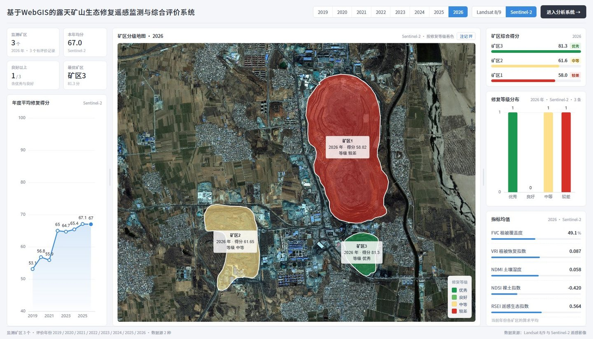
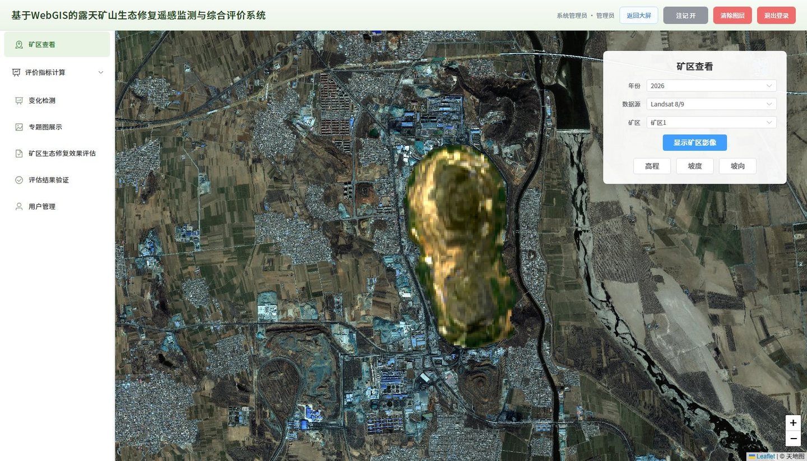
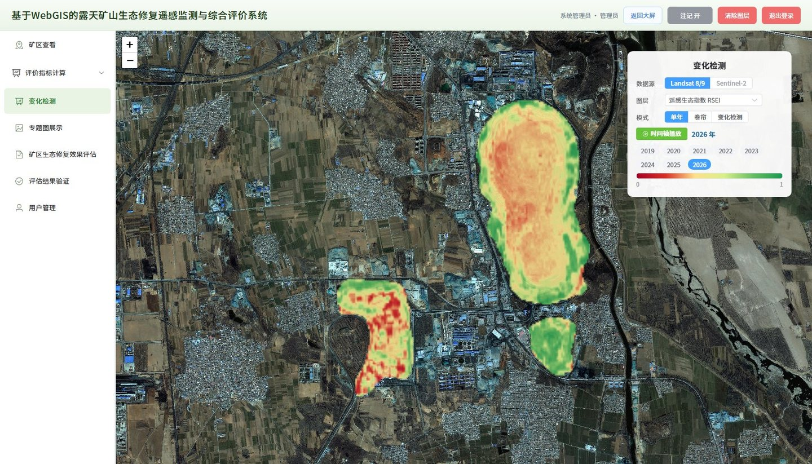
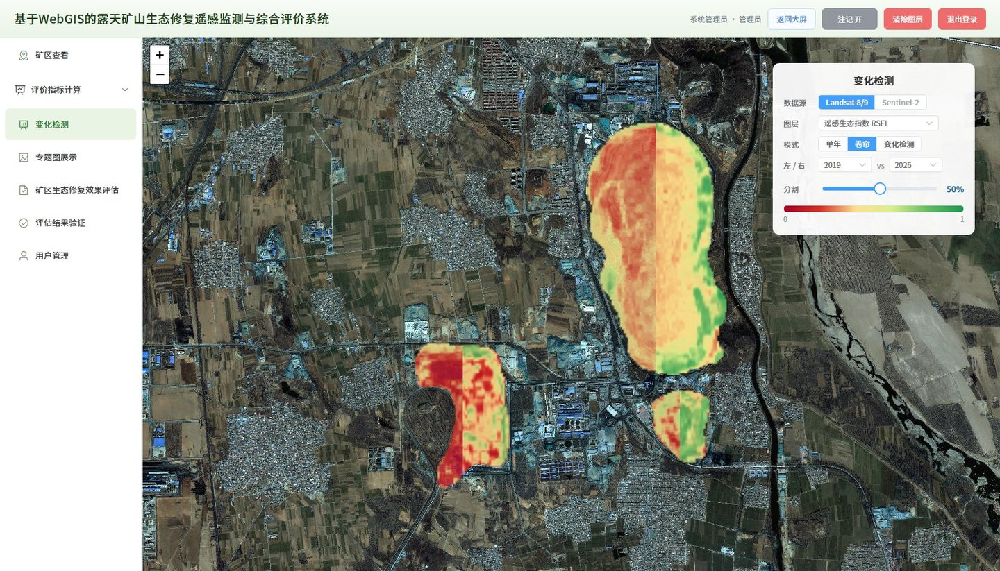
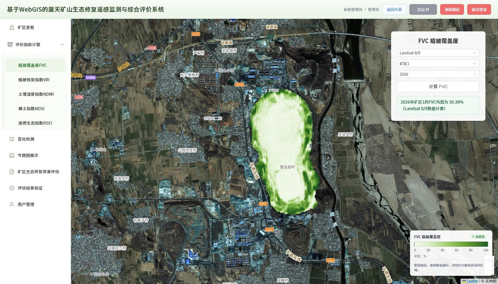
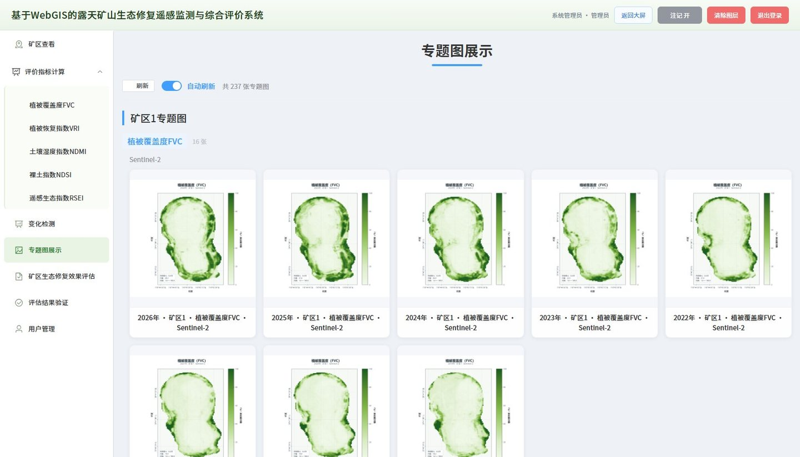
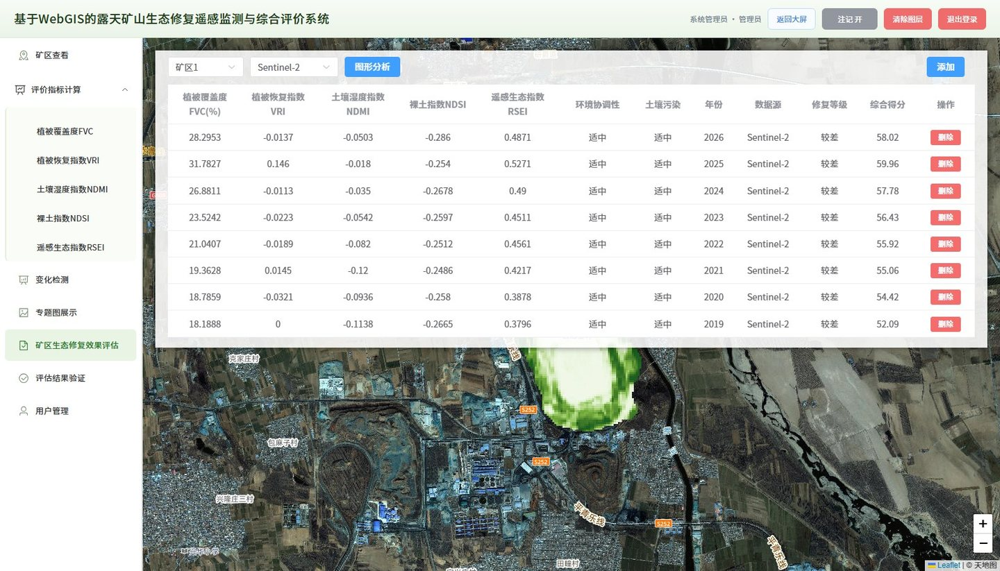
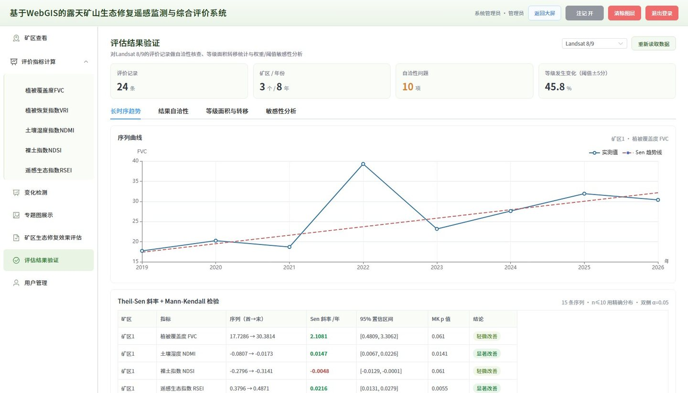
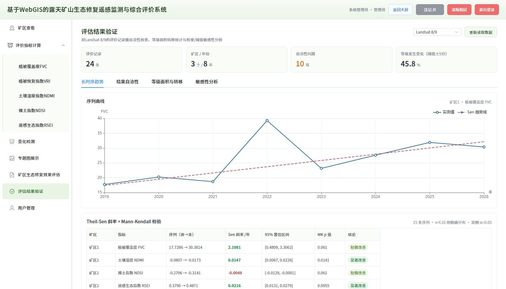
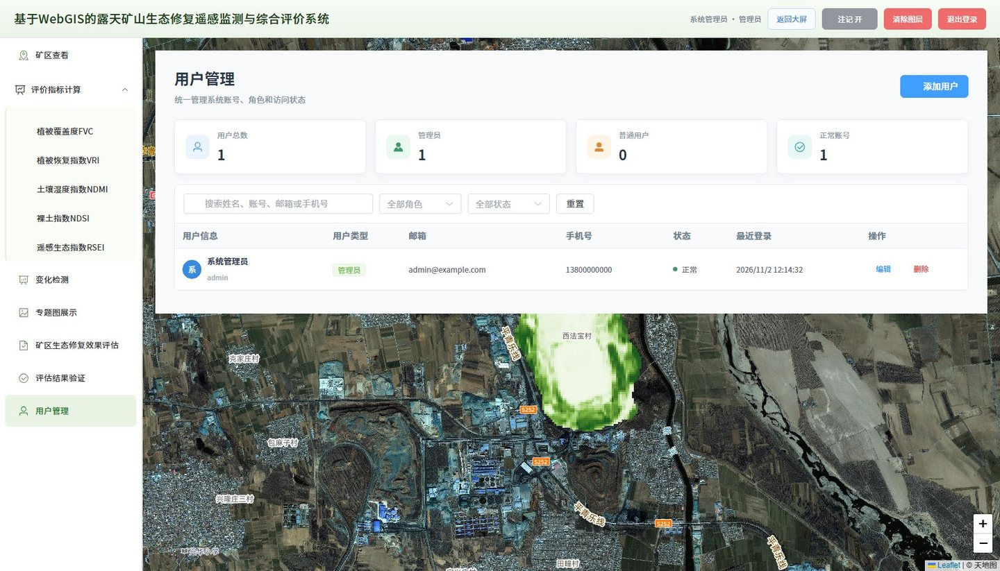

# 基于 WebGIS 的露天矿山生态修复遥感监测与综合评价系统

面向露天矿山生态修复的多时相遥感监测与效果评价前端，Vue 3 + Vite 构建，地图采用 Leaflet，图表采用 ECharts。

## 功能模块

- **监测大屏**：按年份与数据源查看矿区排名、年度趋势、等级分布
- **矿区查看**：矿区影像裁剪发布、DEM 地形派生（高程/坡度/坡向）
- **变化检测**：多时相指标变化对比与分类统计
- **评价指标计算**：FVC、VRI、NDMI、NDSI、RSEI 五项指标
- **专题图展示**：按矿区与指标浏览成果图件
- **效果评估**：指标录入、权重配置、等级评定与综合得分
- **结果验证**：结果自洽性、等级面积与转移、敏感性分析、长时序趋势（Sen + MK）
- **用户管理**：账号、角色与启用状态维护

## 技术栈

| 层 | 选型 |
|---|---|
| 框架 | Vue 3（Composition API） |
| 构建 | Vite 4 |
| 组件 | Element Plus |
| 状态 | Pinia |
| 地图 | Leaflet 1.9 |
| 图表 | ECharts 5 |

## 目录结构

```text
src/
├── assets/       配置、工具方法、评价数据
├── components/   页面组件（大屏、矿区查看、指标计算、评估等）
├── router/       路由（hash 模式）
├── services/     接口封装
└── stores/       Pinia 状态
```

## 本地运行

```bash
npm install
npm run dev
```

默认访问 `http://127.0.0.1:5173`，`/api` 请求由 Vite 代理到后端服务。

生产构建：

```bash
npm run build
```

产物输出到 `dist/`。

## 配置说明

- 天地图浏览器端 key：`src/assets/config.js` 中的 `tdtToken`，可在天地图控制台为该 key 设置授权域名；
- 接口代理地址：`vite.config.js` 中的 `server.proxy`，按实际后端端口调整。

## 说明

本仓库仅包含前端代码。后端服务（Flask + 遥感栅格处理 + GeoServer 发布）与原始影像数据不在仓库内，需单独部署并与前端接口对接。

## 运行截图

### 监测大屏

按年份与数据源查看矿区得分排名、年度趋势、等级分布与指标均值。



### 矿区查看

按年份、数据源、矿区裁剪并发布影像，支持高程、坡度、坡向派生。



### 变化检测

按指标进行多时相监测，支持单年浏览、时间轴播放与卷帘对比、变化检测三种模式。



卷帘对比：左右两侧为不同年份，拖动分割线查看同一位置的差异。



### 评价指标计算

五项指标共用统一页面，下图为 FVC 计算结果。



### 专题图展示

按矿区与指标浏览已生成的成果图件。



### 矿区生态修复效果评估

管理评价记录，展示五项指标、环境协调性、土壤污染、年份、修复等级与综合得分。



### 评估结果验证

对评价结果做自洽性核查、等级面积与年际转移统计、权重与阈值敏感性分析。



长时序趋势：逐像元 Sen 斜率 + Mann-Kendall 显著性检验，输出各矿区各指标的变化结论。



### 用户管理

管理系统账号、角色与启用状态。



## 演示账号

系统内置管理员账号 `admin`，初始口令见 `src/assets/userStore.js` 中 `DEFAULT_PASSWORD` 的拼接结果；正式使用前请在「用户管理」中修改。

## 许可证

本项目采用 [MIT License](LICENSE) 开源。
